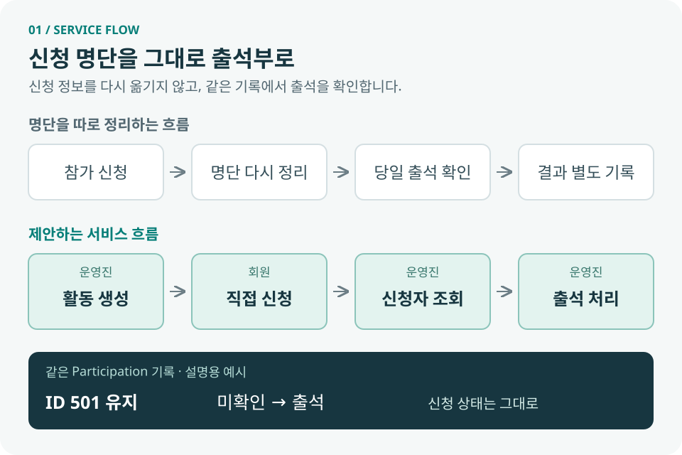
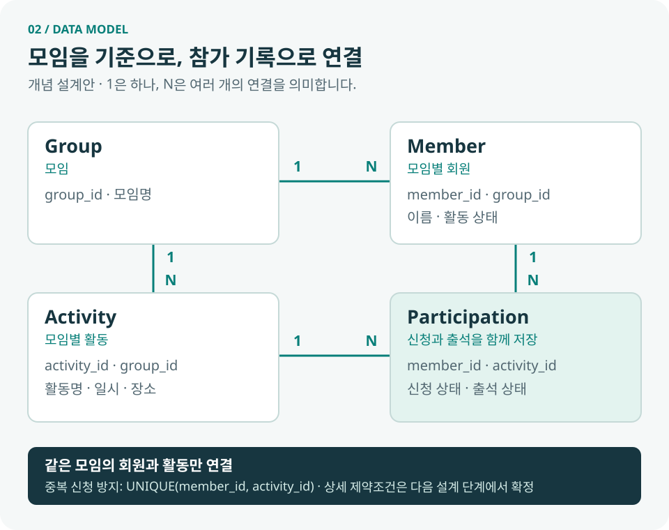
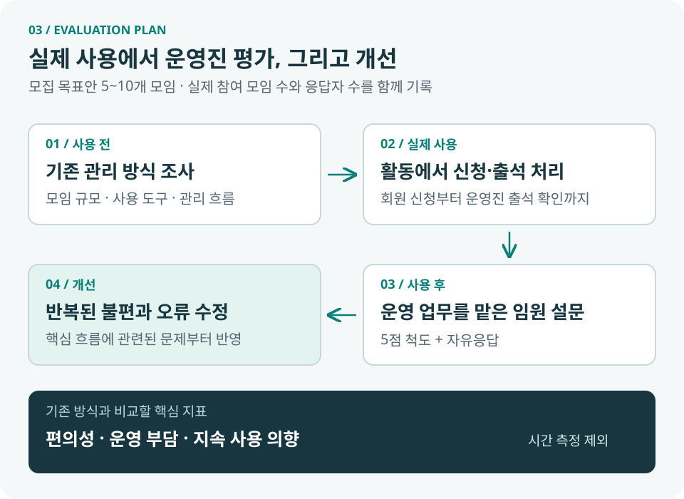

# 참가 신청 명단을 그대로 출석부로 사용할 수 없을까?

> **동아리·소모임 활동 신청 및 출석 통합 관리 서비스**
>
> 회원이 직접 신청한 명단을 운영진이 당일 출석부로 사용하는 웹 서비스

작성일: 2026년 11월 3일 · 소프트웨어공학 학기 프로젝트 · 1인 개발

## 1. 프로젝트 개요

| 항목 | 내용 |
|---|---|
| 해결할 문제 | 참가 신청과 출석 확인이 분리되어 같은 명단을 반복 정리하는 불편 |
| 주요 사용자 | 활동에 신청하는 회원, 명단과 출석을 관리하는 운영진 |
| 핵심 목표 | 신청 → 신청자 확인 → 출석 처리를 하나의 흐름으로 연결 |
| 현재 단계 | 기획 및 데이터 설계 — 서비스 구현·배포 전 |
| 검증할 가설 | 신청과 출석을 연결하면 운영진의 반복 작업과 운영 부담이 줄어든다. |

## 2. 주제 선정 배경

동아리 운영 과정에서 직접 겪은 불편을 출발점으로 삼았다.

| 불편했던 작업 | 개선 방향 |
|---|---|
| 신청자를 출석 확인용 명단으로 다시 정리 | 신청 정보를 명단에 자동 반영 |
| 신청 변경 사항을 다른 명단에도 다시 입력 | 하나의 참가 기록을 계속 사용 |
| 신청자와 실제 참석자를 따로 대조 | 신청 상태와 출석 상태를 함께 확인 |

**설계의 초점:** 기능 수를 늘리기보다, 작은 모임에서 신청부터 출석까지 이어지는 과정을 단순하게 만든다.

## 3. 서비스 이용 흐름

| 단계 | 담당 | 처리 내용 |
|---|---|---|
| ① 활동 생성 | 운영진 | 활동명·일시·장소 등록 |
| ② 참가 신청 | 회원 | 활동 확인 후 직접 신청 |
| ③ 신청자 확인 | 운영진 | 신청 기록으로 만든 명단과 인원 조회 |
| ④ 출석 처리 | 운영진 | 같은 기록의 출석 상태 변경·저장 |

**출석 처리 원칙**

- 신청과 출석을 별개의 명단으로 관리하지 않는다.
- 신청 직후 출석 상태는 `미확인`으로 둔다.
- 운영진이 확인한 뒤 `출석` 또는 `결석`으로 변경한다.
- 확인하지 않은 회원을 자동으로 결석 처리하지 않는다.
- 그림의 ID `501`은 같은 기록을 유지한다는 설명용 예시다.

## 4. 이번 학기 구현 범위

| 구분 | 기능 | 완료 기준 |
|---|---|---|
| MVP ① | 회원 명단 관리 | 모임별 회원 등록·조회 |
| MVP ② | 활동 생성 | 활동명·일시·장소·설명 저장 |
| MVP ③ | 직접 참가 신청 | 회원이 신청하고 본인의 신청 상태 확인 |
| MVP ④ | 신청자 명단 조회 | 활동별 신청자와 인원 확인 |
| MVP ⑤ | 출석 처리 | 신청 기록의 출석 상태 변경 후 다시 조회 |
| 기본 설계 | 모임별 데이터 구분 | 다른 모임의 회원·활동이 섞이지 않음 |
| 기본 설계 | 운영진 권한 확인 | 해당 모임의 운영진만 관리 기능 사용 |

- **후속 기능:** 신청 취소, 정원·마감 설정, 활동 수정, 출석률·노쇼 집계, QR 출석, 통계
- **필수 범위 제외:** 별도 로그인 화면, 모바일 앱, 화려한 디자인, Docker
- **MVP 완료 기준:** 회원 등록 → 활동 생성 → 신청 → 명단 확인 → 출석 변경 → 저장 결과 조회가 연결될 것

## 5. 데이터베이스 설계 방향

| 테이블 | 역할 |
|---|---|
| `Group` | 모임 구분 |
| `Member` | 모임별 회원 정보 |
| `Activity` | 모임별 활동 정보 |
| `Participation` | 회원과 활동을 연결하고 신청·출석 상태 저장 |

**초기 설계에서 달라진 점**

- 초기: `Member`, `Activity`, `Participation`의 3개 테이블
- 변경: 모임 구분을 위한 `Group` 추가, 회원·활동에 `group_id` 연결
- 이유: 여러 모임의 회원 명단과 활동을 구분하기 위해
- 유지: 신청 기록을 그대로 출석 처리에 사용하는 구조

**구현 시 지킬 규칙**

1. 회원은 모임별로 등록한다.
2. 같은 모임의 회원과 활동만 `Participation`으로 연결한다.
3. `UNIQUE(member_id, activity_id)`로 동일 활동 중복 신청을 막는다.
4. 출석 처리 시 새 기록을 만들지 않고 기존 기록의 상태를 변경한다.

**다음 설계에서 확정:** 필드·PK·FK, 같은 모임끼리의 연결을 보장할 제약조건, 회원 식별·운영진 권한 방식. Flask + SQLite는 기술 후보로 검토 중이다.

## 6. 실제 이용자 평가 계획

| 항목 | 계획 |
|---|---|
| 모집 목표 | 5~10개 모임 — 실제 모집 결과와 구분 |
| 모임 유형 | 대학 동아리, 운동 모임, 스터디, 학과 소모임 등 |
| 평가자 | 실제 신청·출석 관리 업무를 수행한 임원·운영진 |
| 사용 전 조사 | 모임 규모와 기존 신청·출석 관리 방식 |
| 기존 방식 예시 | 카카오톡 투표, Google Forms, 네이버 폼, Excel, BAND, 수기 |
| 평가 방법 | 실제 활동에서 사용한 뒤 5점 척도 + 자유응답 |
| 결과 기록 | 실제 참여 모임 수, 응답자 수, 문항별 응답 분포, 개선 요구 |
| 제외 항목 | 업무 처리 시간 측정·시간 절감 지표 |

**5점 척도 문항** — 1점: 전혀 그렇지 않다 / 5점: 매우 그렇다. 비교가 어려운 문항은 별도로 표시한다.

1. 기존 방식보다 참가자 명단 관리가 편리했다.
2. 기존 방식보다 당일 출석 확인이 편리했다.
3. 신청자와 실제 참석자를 파악하기 쉬웠다.
4. 반복적인 명단 관리 작업이 줄었다.
5. 전체적인 모임 운영 부담이 줄었다.
6. 앞으로 실제 모임에서 사용할 의향이 있다.

**자유응답:** 가장 편리했던 점 / 불편했던 점 / 개선할 기능 / 계속 사용하기 위해 필요한 기능

**결과 활용:** 기존 관리 방식과 모임 유형별 의견을 살펴보고, 반복된 불편과 오류부터 개선한다. 소수 모임의 결과를 모든 모임에 일반화하지 않는다.

## 7. 개발 일정과 기록

| 일정 — 2026년 | 작업·산출물 | 상태 |
|---|---|---|
| 11월 2일 예정 → 11월 3일 작성 | 주제 제안 블로그 | 작성·GitHub 공개 |
| 11월 9일 | DB 설계·ERD 블로그 | 예정 |
| 11월 16일 | 첫 배포·중간 점검 블로그 | 예정 |
| 11월 하순~12월 초 | 실제 사용 평가·개선 | 예정 |
| 12월 7일 | 최종 제출·회고 블로그 | 예정 |
| 12월 8일 | 최종 발표 | 예정 |

- **개발 방식:** 기능별로 작게 구현·검증하고 커밋
- **기록할 내용:** 설계 변경 이유, 오류 해결 과정, 사용자 의견과 개선 결과
- **공개 위치:** [GitHub 저장소](https://github.com/bullet84/club-attendance) — GitHub Pages는 추후 설정

## 8. AI 활용 기록 — 어떤 작업을 요청했는가

사용 도구: **Codex**. 아래는 이번 작업에서 요청한 내용을 요약한 것이다.

| 작업 | AI에게 요청한 내용 | 반영 결과 |
|---|---|---|
| 초기 구조 검토 | 현재 저장소를 확인하고 프로젝트 요구사항에 맞는 초기 구조를 제안해 달라고 요청 | 기존 실습 저장소와 분리한 폴더 구조, 기술 후보, 단계별 개발 순서 제안 |
| 첫 기록 작성 | 독립 프로젝트 폴더를 만들고 첫 블로그를 작성해 달라고 요청 | `club-attendance` 폴더, README, 블로그·목차, Git 제외 설정 생성 |
| 기획 내용 수정 | 중간 발표 PDF의 내용에 맞춰 블로그를 수정해 달라고 요청 | 직접 경험한 문제, 4개 테이블 설계, 모집 목표, 개발 일정 반영 |
| 그래픽 제작 | 현재 내용을 설명하는 그래픽을 넣어 달라고 요청 | 서비스 흐름·DB 관계·평가 절차 SVG 3개 제작 및 삽입 |
| GitHub 공개 | 프로젝트를 공개 저장소로 푸시해 달라고 요청 | 공개 저장소 생성, 첫 커밋 및 업로드 |
| 글 구조 개선 | 긴 줄글을 구조화하고 참고 내용은 제외하되 AI에 요청한 작업을 남겨 달라고 요청 | 표·목록·도식 중심으로 재구성하고 AI 활용 기록 추가 |

**현재 AI 활용 범위:** 기획 정리, 문서 작성·수정, 도식 제작, 저장소 초기화·공개. 서비스 코드와 DB 구현은 아직 진행하지 않았다.

## 9. 다음 작업

- [ ] 네 테이블의 필드·키·제약조건 확정
- [ ] 회원 식별 및 모임별 운영진 권한 설계
- [ ] 실행 환경 구성 후 회원 등록·조회부터 구현
- [ ] 첫 배포 준비와 평가 모임 섭외

---

[개발 기록 목차로 돌아가기](index.md)
